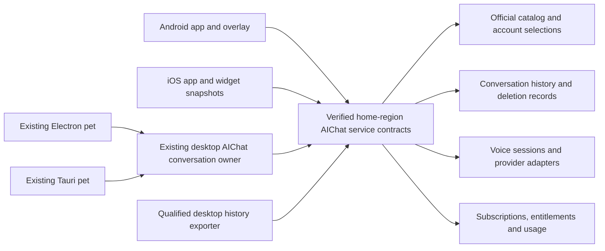

# AI Pet implementation and acceptance specification

Status: accepted by the user on 2026-11-13, Asia/Tokyo. Product decisions and the acceptance record are in the [development plan](ai-pet-cross-platform-plan.md). The engineering defaults below are accepted implementation baselines subject to their documented validation gates, not claims of completed work.

Updated: 2026-11-13, Asia/Tokyo. Repository baseline: `6332c09`.

Implementation and current test evidence: [M0 implementation record](ai-pet-m0/README.md). This specification remains the accepted target, rather than a statement that all described capabilities exist.

## 1. Delivery boundary

Ship a standalone Kotlin Android pet app first, with macOS and Windows conversation continuity ready at that launch. Ship the Swift/SwiftUI iOS app and widget afterward. Each public platform release covers mainland China, US, Spain, South Korea, Japan, and France, with Simplified Chinese, English, Spanish, Korean, Japanese, and French across UI, text, ASR, and TTS.

The mobile app offers official catalog characters, matching licensed 2D appearances, text assistance, and user-started continuous voice with spoken interruption. Voice continues across app switches and screen lock. Only one voice session is active per account; a second device requests takeover. Actual audio/network interruptions pause capture until deliberate resume.

Maintain desktop appearance and interaction patterns; integrate catalog identity, shared history, appearance selection, automatic eligible-history migration, and consumer voice-session coordination through the existing AIChat owner. A new desktop voice engine, custom/private-agent selection, skin marketplace, 3D characters, remote desktop control, long-term memory product, and timed Live Activities are outside the accepted launch boundary.

## 2. System ownership

The service boxes are required responsibilities to map onto canonical existing services or explicitly commissioned additions. They are not evidence that a new backend exists or a requirement to create separate deployable services. Keep the local MCP daemon on loopback; it is not the phone's cloud gateway.

| Responsibility | Authority | Client responsibility |
| --- | --- | --- |
| Account and home service region | Verified account service; home region remains stable while traveling | Secure native credentials, token lifecycle, explicit sign-out, language independent of region |
| Official characters and rights | Canonical catalog owner | Display only eligible entries; persist selected stable identity; keep appearance distinct from persona |
| Shared history | Account's home-region history service | Local cache, pending commands, cursor recovery, deletion application, clear sync/error status |
| Voice ownership | Account-scoped service lease plus native audio lifecycle | Obtain lease, capture/playback, turn detection, interruption, stop/mute, release resources |
| Entitlements and consumption | Verified server purchase and usage records | Show trial/allowance and purchase/restore outcomes; never grant quota from an unverified local success flag |
| Pet windows and widgets | Each platform host | Rendering, focus, drag, accessibility, cached widget snapshots; no credentials in presentation snapshots |

When the catalog is unavailable, show an explicit retry state or an authorized cached selection. Do not invent a public catalog from local private agents. Withdrawal/version changes require a documented catalog policy; preserve existing conversation attribution even when a new conversation can no longer use that character.

## 3. Repository work map

Paths marked “new” are proposed locations, not scaffolds already created. Confirm build/layout integration before adding them. Application code does not import another application's internals.

| Workstream / accountable role | Existing or proposed scope | Deliverable |
| --- | --- | --- |
| Contract owner + backend team | New `contracts/ai-pet/`; canonical external AIChat/service sources | Versioned schemas, capability semantics, representative fixtures, endpoint/auth mapping, data ownership |
| Android owner | New `apps/ai-pet-android/` | Native app, account/onboarding, catalog, local history cache, overlay, microphone FGS/audio, purchases |
| iOS owner | New `apps/ai-pet-ios/` | Native app, native audio session, Widget Extension/App Group snapshots, purchases |
| Desktop owner | `src/pet/`, `apps/aichat-desktop/`, `apps/aichat-rust/`; canonical AIChat frontend | Compatibility adapters, shared selection/history integration, qualified migration, consumer voice admission/takeover/fencing |
| Catalog/art owner | New `assets/pets/` or canonical catalog asset package | Licensed asset manifests, animation metadata, poster frames, localization/accessibility labels |
| Service/operations owner | Canonical external services; deployment repository to be identified | Regional routing, authentication, history, voice, entitlement/metering, monitoring and recovery |
| QA/release owner | Existing desktop tests; new app-local tests and acceptance evidence | Contract compatibility, regional/device/language matrix, migration, billing, native lifecycle, release evidence |

These are roles, not claims that people have been assigned. Name owners during M0. Changes to the actual products later must follow the repository's version-bump and application-isolation rules; planning documents do not change product binaries.

## 4. Contract specification to produce in M0

Use conceptual operations until canonical APIs are verified. The source proposal's `/v1/...` routes are not an implementation dependency by name.

| Contract | Required semantics |
| --- | --- |
| Account/session | Stable account ID, home region, login/refresh/revocation, sign-out, account recovery, account-deletion behavior; no reuse of a local owner hash as cloud identity |
| Catalog/selection | Stable official character ID and version, eligibility, licensed assets/voice availability, account-scoped selection, update/withdrawal semantics |
| Conversation | Account/character binding, stable conversation/message/request IDs, append/cancel/read/clear/delete, server ordering, incremental sync cursor, status of incomplete turns |
| Streaming | Request and turn identity, monotonic sequence, text/audio boundaries, format negotiation, end/error/cancel, explicit supported capabilities; late superseded output is discarded |
| Voice | Session ID, account-scoped lease/fencing generation, explicit takeover, input/output negotiation, interruption/cancel, pause/resume/end, mute, service expiry, usage admission |
| Migration | Source format/version/installation/conversation/message identities, verified account and official-character mapping, snapshot revision, resumable batches, deduplication, receipts, deletion reconciliation |
| Entitlements | Trial, subscription lifecycle, verified purchase channel/product mapping, allowance version, usage reservation/settlement, restore/refund/revocation; no duplicate grants |
| Deletion | Durable deletion/clear markers, offline-device convergence, migration suppression, account scope, backend/provider/backup retention guarantees |

Keep capability versions separate from product versions. Test old/new desktop-service combinations and missing optional fields. A service lacking required mobile launch functionality blocks launch; optional capability fallback is not permission to claim required voice/history features are implemented.

The one-session guarantee covers this account's consumer AI Pet conversations across mobile and desktop. Existing desktop AIChat voice entry points must join the lease/admission protocol through an adapter; unrelated transcription/dictation tools are not pet conversations. Unsupported older consumer-voice clients must be adapted or refused at the relevant voice service boundary with a feature-specific explanation while ordinary chat keeps working. If an existing legacy route can bypass session ownership, close that gap before claiming the guarantee or passing the launch gate; do not silently exempt it.

## 5. Conversation synchronization and migration

### Shared conversations

Use server ordering rather than device clocks to merge accepted messages. Preserve stable client request identity across retries. After an uncertain submission, query its status before retrying; do not create a second model request. Separate a locally saved draft from a message accepted by the service. A disconnected device can retain a draft and display cached history without pretending it has delivered the message.

Accepted default: allow concurrent text input from devices, order it at the service, and serialize generation within each conversation. Cross-device cancellation targets a specific request. Persona changes switch conversation identity rather than relabeling an existing conversation. Stop an active voice session before changing its account or persona; switching appearance alone does not change conversation ownership.

### Automatic migration

The accepted scope is verified same-account consumer history mapped to an official character through a supported exporter. Preserve local originals, original order/timestamps, and source attribution. Show progress and the counts migrated, skipped, and awaiting verification.

Exclude private custom-agent work, scheduled/peer/channel conversations, tool/system records, unfinished drafts, local settings, credentials, approvals, and unmapped history. Do not identify eligibility only from `role: user | assistant`, matching names/avatars, or the currently signed-in account. The inspected local persona store cannot by itself establish eligibility for official-character migration.

Accepted migration process:

1. Verify account/home-region binding and canonical source-format support; obtain official-character mapping and record provenance. Unverifiable rows remain local with a reason.
2. Take a bounded snapshot. Export only supported completed conversation records; do not follow local file links or upload their targets.
3. Import historical records through a dedicated import operation, never the live message-submission or model-inference path. Deduplicate by account and stable source identities; use content digests to detect changed content, not to infer identity.
4. Acknowledge batches and resume from receipts. Reconcile uncertain outcomes before retrying. Pause on account/region change, source mutation, deletion, cancellation, or unsupported format.
5. Compare source/destination totals and ordering; preserve local originals. Respect server and source deletion markers so cleared history cannot return through a later migration or reconnect.

Migration is not complete merely because the uploader returned success. The release proof must include multiple desktop installations, retry/crash recovery, duplicate imports, wrong-account rejection, unsupported formats, and deletion during migration. The canonical exporter and account-mapping contract are launch-blocking dependencies.

### Retention

Retain synchronized text until the user deletes it. Raw microphone audio is transient and is not retained after processing; diagnostic logging must not accidentally record it. Provider retention and backup-deletion timing must be verified and disclosed before launch. Deletion propagates across devices and prevents migrated copies from reappearing. Local originals preserved for migration recovery must still honor a later user deletion once ownership/mapping is established; preserving an original is not a permanent exception to deletion.

## 6. Voice implementation and user behavior

Use a native voice owner separate from the renderer. Start capture only after explicit user action, applicable permission, entitlement admission, and ownership of the active session. On Android, begin from a visible app flow and continue through a microphone foreground service. On iOS, use the appropriate recording/playback audio session and genuine audio background mode. Widget display and pet visibility do not confer microphone authority.

Model independent dimensions instead of a single animation enum:

- Session: connecting, active, paused, ending, ended.
- Turn: listening, generating, playing, interrupted; capture can remain active for speech detection during playback.
- Transport/authorization: ready, reconnecting, unavailable, expired.
- Presentation: visibility, pose/emotion, mouth level, permission/error indication.

Spoken interruption stops local playback promptly, invalidates queued old audio, cancels the superseded generation/TTS where supported, and begins the next user turn. Tag all chunks with session/turn/generation identity so late packets cannot resume an interrupted answer. Echo processing and speech detection must prevent the pet's own output becoming a user turn. Measure end-to-end interruption from user speech onset as well as local stop after detection.

| Event | Required behavior |
| --- | --- |
| Switch apps / screen lock | Continue the active voice session; visibility changes do not restart capture or create another session |
| Phone call / competing recorder / network loss | Pause capture, stop stale playback, show reason; deliberate resume is required after the cause is resolved |
| Second device starts voice | Ask before takeover; replace the lease and immediately fence the old session at the service. Notify a connected old client to release capture/playback; an unreachable client stops via its local connection/lease watchdog within a measured bounded timeout. Prevent overlapping usage grants. |
| Mute | Stop sending user audio; clearly indicate mute; do not silently resume transmission after a route or device change |
| End call / sign-out / permission revoked | Stop capture and playback, cancel owned requests, release lease/resources, settle usage once |
| App process terminated | No automatic microphone restart; recover history/status on next open without replaying the interrupted request |
| Voice allowance exhausted | End/pause voice with an explicit explanation and purchase path; keep ordinary text available under its own service policy |

Accepted interruption-recovery baseline: restore transport/status in the background if useful, but keep capture paused until the user resumes. Resume revalidates permission, lease, entitlement, audio focus/session, and native service-start eligibility. If Android's microphone service was torn down, use a visible app flow or another explicitly validated eligible user action; a reconnect alone cannot restart capture. Test resume after phone-call/network interruption while backgrounded and locked.

Session leases need bounded expiry and server fencing so an offline former device cannot remain an authorized sender or spend allowance after takeover. Freeze the local watchdog timeout during M1 and test a partitioned old device: local capture/playback stops within the bound, buffered audio is discarded, and reconnect cannot resurrect the revoked session. Remote takeover is not a claim of instantaneous physical microphone release on an unreachable device.

## 7. Rendering and platform surfaces

Use matching licensed 2D appearances for the launch catalog. Define an asset manifest with stable identity/version, provenance/license reference, download integrity, dimensions, anchors, poster image, frame timing, and supported animations. Support idle, happy, listening, thinking, speaking, sleeping, and error poses; derive pose from conversation and platform state rather than allowing model text to control permissions or the OS.

Use amplitude-driven mouth movement for the initial speaking animation. Cache assets and retain an authorized static fallback if animation/download is unavailable. Respect reduced motion and stop unnecessary drawing while invisible or locked. Catalog/voice licensing must be confirmed; the repository's software license does not establish character or voice rights.

Android: use a small overlay window and separate input panel; validate drag threshold, safe areas, keyboard focus, touch-through, rotation, system bars, and apps that hide overlays. If overlay permission is denied, all in-app conversation features still work.

iOS: the app owns conversation and voice; the widget displays an account-safe cached snapshot and opens the correct conversation. Default widget content excludes message text. Logout clears shared snapshots. No continuously running widget animation, general-purpose global overlay, or PiP workaround is part of this plan.

Desktop: keep existing hit regions, drag/menu behavior, scale, permission bubbles, draft handling, and app lifecycle. Account/persona/history and voice-ownership adaptation belongs in the existing trusted AIChat owner and validated host bridge; do not put bearer credentials or a second conversation engine in the pet renderer.

## 8. Work packages and completion evidence

| Package | Dependencies | Output / completion evidence |
| --- | --- | --- |
| P0 Contract and ownership discovery | Accepted plan | Named owners; verified auth/catalog/history/exporter/voice/entitlement contracts; classified existing capability versus required addition; signed-off region/channel map |
| P1 Native platform spikes | Agreed contract fixtures; real service access for integration claims | Android overlay/input and native voice; iOS audio/lock/widget feasibility; actual six-language ASR/TTS samples and regional connectivity observations |
| P2 Shared schema/fixtures and asset manifest | P0 | Compatible request/event/selection/snapshot/migration schemas; invalid/legacy fixtures; licensed launch asset inventory |
| P3 Android app foundation | P0, P2 | Login/onboarding, official catalog, account-region/language handling, cached history, text/stream/cancel, explicit offline state |
| P4 Shared history and migration | P0, P2 | Account-scoped synchronization, deletion markers, qualified exporter/importer, progress/recovery, cross-device consistency tests |
| P5 Desktop adapters | P2, P4, voice-ownership contract | macOS/Windows selection/history integration, migration, and consumer voice admission/takeover/fencing; existing Electron/Tauri UI and mixed-version contracts preserved |
| P6 Android continuous voice | P1, P3, voice/entitlement contracts | Spoken interruption, background/lock, takeover/resume rules, native cleanup, device/audio route acceptance |
| P7 Subscriptions and allowance | P0, P2, selected channel sandboxes | Server-verified trial/subscription entitlement, idempotent usage, purchase/restore/refund/exhaustion acceptance |
| P8 Android launch qualification | P3–P7 | All six markets/languages, native device matrix, performance/power report, release/rollback/support package; desktop continuity gate passes |
| P9 iOS implementation and launch | P1–P2, approved services and lessons from Android | SwiftUI app, native continuous voice, widget, purchase adapter; own real-device/market/language acceptance and release evidence |

P4/P5 and Android app development can proceed concurrently once the contracts are established. iOS feasibility starts early; its public release follows Android. A mock can unblock UI/contract work but does not close P0 service evidence or P1 real integration gates.

## 9. Accepted engineering acceptance baseline

These are accepted initial test targets, not measured performance or provider promises. M1 must measure them and report any required revision explicitly; a failed required feature is not silently converted into a launch fallback.

| Area | Accepted initial gate |
| --- | --- |
| First useful experience | Test a new-user flow in every language: sign in, choose official character, ask a question, summarize supplied text, create a simple plan, find the same conversation on desktop |
| Input feedback | Local interaction feedback p95 ≤100 ms on the agreed minimum devices |
| Text latency | First visible response p50 ≤2 s and p95 ≤5 s under a documented healthy-network profile; report each market/language separately |
| Voice turn latency | End of user speech to first reply audio p50 ≤2 s and p95 ≤4 s; separate ASR, model, and TTS contributions |
| Spoken interruption | Reply audio stops p95 ≤500 ms from user speech onset; no stale audio resumes; evaluate false interruptions and missed speech with per-language fixtures |
| Online history | Committed text/selection visible on another connected device p95 ≤5 s; reconnect catches up without duplicates or deleted-history resurrection |
| Continuous session | A 30-minute multi-turn device test including app switching/lock, then interruption/recovery, route changes, mute, stop, and process termination |
| Migration correctness | Zero wrong-account imports, duplicate historical messages, inference replays, unauthorized/migration-caused source deletions, or resurrection of deleted records; explicitly requested deletion reaches mapped copies and prevents reimport |
| Purchases/usage | Verified sandbox purchase through refund/revocation for each selected adapter; idempotent grants/settlement across retries and device changes |
| Privacy/lifecycle | No raw mic audio in persisted app/service diagnostics; capture releases on required stop/pause events; logout removes account-bound widget/cache exposure |
| Accessibility | Screen-reader labels and native controls; scalable text/IME; reduced motion; usable text paths with overlay/mic permission denied |
| Power/stability | Measure 30/60-minute idle, overlay, text, and voice workloads against a same-device baseline; freeze power/temperature/crash budgets after M1 measurements |

Initial OS support candidates from the reference proposal are Android API 26+ and iOS 17+. Validate them during M1 and explicitly raise the minimum if required; target SDK/store submission requirements are checked at implementation/release time. Test current and minimum-supported OSes, an Android device close to stock plus two selected-market OEM families, iPhones with different performance levels, speaker/headset/Bluetooth routes, and existing supported pet-capable macOS/Windows desktop builds. The Windows experimental CEF path is not assumed to provide pet functionality.

Preserve existing Electron `pet-window`, `pet-lifecycle`, and `pet-renderer` tests; Tauri `pet-renderer`, `pet-audio-capture`, and relevant Rust host tests. Add shared contract and migration fault fixtures. Run appropriate native smoke checks for focus, multi-monitor movement, audio, lock, and permissions. Record coded, built, real-device verified, service-integrated, and store-reviewed status separately.

## 10. Launch-blocking evidence and ownership

| Gate | Accountable role | Evidence required before passing |
| --- | --- | --- |
| External APIs | AIChat/backend owner | Source/spec access, supported auth and region assignment, catalog/version mapping, history/exporter, streaming/voice including legacy-client admission, deletion and entitlement contracts |
| Catalog/voice rights | Catalog/product owner | Launch character inventory, asset/voice use and redistribution rights, regional availability, withdrawal/update behavior |
| Voice quality and regional access | Voice/service owner + QA | Six-language recognition/synthesis, real interruption/echo behavior, session capacity, provider retention, observed latency/cost |
| History migration | Desktop + backend owners | Verified source/account mapping, eligible exporter, batch/receipt/deletion behavior; historical formats without proof remain local |
| Commercial rules | Product + billing owner | Trial and monthly allowance sizes, billing unit, refill/expiry/upgrade rules, price/cost budget, text availability policy, refund/revocation behavior |
| Distribution | Release owner | Selected mainland-China Android channels, international Play path, iOS storefronts, channel purchase requirements, application identifiers/signing/account readiness |
| Retention/deletion | Backend + operations owners | Text deletion across service/devices/providers, raw-audio processing policy, backup retention/deletion schedule, tombstone/source-import suppression |
| Capacity and dates | Delivery owner | Named team, staffing availability, estimates per package, critical path and release dates based on M0/M1 findings |

Final prices, providers, channel adapters, asset counts, and calendar dates are intentionally evidence-gated rather than invented. Each missing gate blocks the corresponding integration/release claim; it does not block independent contract fixtures or platform experiments. No production implementation, deployment, account migration, or publishing has been performed by this planning task.
