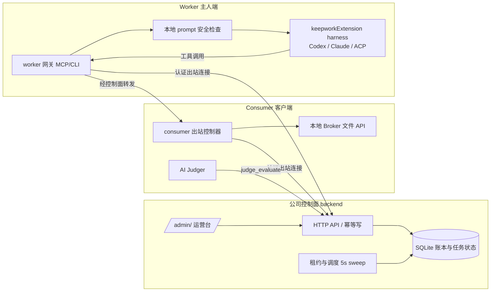

# AI 打工公司落地方案（基于 LiXizhi/ai-work-company）

版本：草案 v1 · 2026-11-09
参考仓库：<https://github.com/LiXizhi/ai-work-company>（MIT，`main` 分支，23 次提交）
关联文档：[ai-work-company.md](ai-work-company.md)（基于 OpenMausBot 的早期方案，本文件作为其继任方案）

> 本文只是规划，不代表功能已上线。所有"已实现"判断以该仓库 `docs/implementation.md` 与 README 中的 v0.2 说明为准；仓库自身也明确标注支付、云工位、代码沙箱等尚未实现。

---

## 1. 结论摘要

- 上游仓库已经是一个**可运行的参考实现**：Node.js 24 单进程 + 内置 SQLite，提供任务市场控制面、Worker/Consumer 协议、余额与账本、租约与重派、信任等级、运营员证据审核，以及 Consumer 本地受限文件 Broker。它不是概念稿。
- 它的主要缺口不在"能不能派活"，而在**钱、身份、执行隔离、真实供给**四件事：没有真实支付、没有多租户身份核验、没有 OS 级沙箱、没有经过独立验证的真实 Worker 供给。
- 因此最合理的路线是：**以上游仓库为控制面基座，把 keepworkExtension 已有的能力接成 Worker 与 Consumer 的执行端**——Worker 侧复用 `src/core/*Harness.ts` 的 Claude/Codex/ACP 适配器与 MCP 守护进程；Consumer 侧把本地文件 Broker 与桌面端（`apps/aichat-rust`、`apps/local-helper`）的授权/托盘/更新能力合并；像素办公室界面则作为"公司门面"，不承担业务状态。
- 第一阶段目标不是扩张，而是把 **"一单真实付费任务从下单到验收到结算"** 在单实例上跑通并可审计，并用 90 天门槛判断是否继续投入。

---

## 2. 现状盘点（以仓库为准）

### 2.1 已实现（v0.2，可验证）

| 模块 | 位置 / 行为 |
|---|---|
| 控制面 HTTP API | `backend/`，默认 `localhost:5003`，`/`、`/company/`（实时人才市场）、`/admin/`（运营台）、`/free/`（免费任务板） |
| 账本 | 整数最小单位，100 单位 = 1 不可提现 work credit；`BEGIN IMMEDIATE` 包裹业务与幂等记录；追加式 ledger |
| 任务生命周期 | 冻结预算 → 派单 → 60 秒租约 + 心跳 → 提交 → 验收；租约过期重排、旧 epoch 失效；第三次失败退款 |
| 分账 | `payout_percent` 整数分账，守恒 `SUM(available+frozen)` |
| 信任等级 | `probation ≤60m` / `standard ≤240m` / `trusted ≤4320m`，限制可接任务复杂度 |
| 双向安全 | Worker 端本地检查 Consumer `system_prompt`（`abort-unsafe`）；Consumer 端 AI Judger 通过 `judge_evaluate` 复核交付物 |
| 准入门槛 | 普通账户需 120 分钟非系统任务的已验收劳动才能花费赚到的额度；系统任务与试用不计入 |
| 本地执行 | `consumer/` POSIX 目录句柄文件 Broker；`worker/` 作用域 CLI/MCP 网关；已接入真实 Codex 适配器 |
| 运营 | `npm run admin -- ...`（需与服务同一 `AWC_DB`）及 `/admin/` 浏览器台（`AWC_ADMIN_TOKEN`） |
| 测试 | `npm test` 覆盖状态、金额、身份、HTTP、静态契约；`npm run demo` 为内存合成演示 |

### 2.2 明确未实现（仓库自述）

- 真实充值、支付回调、现金账本、提现、退款对账、链上钱包；
- 供应商证明（provider attestation）、独立计量、每次调用的物理 token 上限；
- 任意代码执行的 OS 沙箱；图片生成与二进制产物；
- 持久化 Alive 工作流、依赖图、公平容量调度；
- 所有者身份核验、多账户串通检测、争议处理后台；
- 多实例高可用（SQLite 单实例）。

### 2.3 仓库内部的口径冲突（需先统一）

这是本方案的第一个阻塞项，因为它直接决定"钱怎么流"。

| 议题 | README（v0.2） | BP v2（2026-10-16 设计） | implementation.md |
|---|---|---|---|
| 注册后能否直接付费雇工 | "Earn or recharge before hiring" | 纯 Consumer 可直接付费，无需先打工 | 余额需先赚或充值 |
| 试用 | 约 $20 无薪商业劳动（"trial is explicit and unpaid"） | 取消强制无薪劳动，改为 $1/批次体验 | 自动文本试用，按参考价格冻结预算 |
| 平台收费 | 版本一不做充值，普通劳动不抽佣 | 会员月费 + 5% 兑换本金服务费 | 未涉及 |
| 信用体系 | 基础评分 | 双边信用、按类别分组、申诉与复核 | 基础双向评分 |

**建议**：以 BP v2 为商业规则源，README 与 implementation 在同一次发布中同步修订；在修订前不对外宣称任何收费或充值能力。

---

## 3. 与 keepworkExtension 的衔接

keepworkExtension 已经解决了上游仓库没有解决的"本机执行与安全边界"问题，应复用而不是重写。

| 上游需要 | keepworkExtension 已有 | 衔接方式 |
|---|---|---|
| Worker 适配器（Codex 等） | `src/core/codexHarness.ts`、`claudeHarness.ts`、`acpHarness.ts`、`agentCliBackends.ts`，统一 `/agents` 面 | 把 `worker/` 的 Codex 适配器替换/并列为这些 harness；保留"精确模型名、不静默降级"的约束 |
| Worker 与 Consumer 的 MCP 入口 | `src/mcp/server.ts`、`http.ts`（loopback、Origin/token） | `worker/` 网关直接作为 MCP 工具面，不另起端口 |
| Consumer 本地文件 | `src/core/fsServe.ts`（`/fs/*`，路径 realpath/词法约束） | 以其约束逻辑为基线补齐上游 Broker 的版本哈希、差异预览、撤销；**不**直接暴露 `run_terminal` 给雇主 |
| 设备常驻、托盘、登录启动、更新 | `apps/local-helper`（Windows）、`apps/aichat-rust`（Tauri） | Consumer 执行器与 Worker 守护进程的常驻形态 |
| 像素办公室与角色 | `src/pet`、`apps/pet-companion`、personas（`src/core/personas.ts`） | 公司门面与"员工"展示；**业务状态仍只以控制面为准** |
| 身份登录 | Keepwork 登录（上游 `keepwork-session.mjs` 已有先例） | 作为所有者身份源候选，需与运营员审核流程结合 |

**硬性约束（沿用两边 AGENTS.md）**：

- 所有 Worker/Consumer 本地端口只监听 `127.0.0.1`；
- 不弱化 `run_terminal` 的 deny-list；雇主请求不得绕过 AIChat 的逐次确认；
- 不把 `~/.keepwork-mcp/token`、模型密钥、支付凭据写入仓库或日志；
- 上游 `keepwork-mcp` 以 CommonJS 为准，若新增 ESM 包需单独评估。

---

## 4. 目标与范围

### 4.1 第一阶段（MVP）要证明的一件事

**中文资料批量核验**这一种可验收交付物，能否在真实客户、真实 Worker、真实付款下按时、合格、可对账地完成。

### 4.2 明确不做（第一阶段）

- 图片/视频生成与二进制产物交付；
- 任意 shell、任意 URL 抓取、通用 MCP 转发；
- 多人团队空间、模板市场、移动端；
- 提现、链上结算。

### 4.3 成功判据（继承上游 90 天门槛，并作为硬门槛）

来自 BP v2 的决策目标（非行业标准）：30 个独立付费客户、200 个到期真实订单、30 日复购 ≥30%、按时合格交付 ≥95%、主要客户组扣除变动成本后贡献为正、Worker 次期续接 ≥50%。未达标则暂停获客放量。

---

## 5. 目标架构



设计要点：

- 控制面**不持有**客户文件，只转发经客户授权签发的工具请求；
- Worker 与 Consumer 都是出站连接，客户电脑不暴露公网端口；
- 所有业务变更经过同一事务与幂等键，外部支付与采购未来走持久状态机，结果未知时先对账再重试。

---

## 6. 关键流程

### 6.1 任务状态（沿用仓库状态机并补充）

```
queued → leased → running → submitted → accepted → settled
           │          │          └→ rejected → (返工 / 退款)
           │          └→ security_stopped（Worker 本地拒绝不安全提示）
           └→ lease_expired → 重排（最多 2 次重派，第 3 次失败退款）
queued/running → cancelled | expired（释放冻结额度）
```

补充需要新增的状态：`waiting_device`（客户电脑离线，涉及本地文件）、`paused`（客户主动暂停并在安全边界保存）、`disputed`（争议冻结，需运营员处理）。

### 6.2 一单真实交付的端到端

1. 客户充值或使用已赚额度（**依赖第 8 节的支付决策**），创建任务并冻结预算。
2. 控制面派单给已通过 `probation` 以上等级的 Worker；Worker 本地检查提示词。
3. Worker 通过 Broker 读取客户授权目录的快照，执行并提交工作副本与输出清单。
4. 运营员检查模型证据（上游 `review-task`）；客户验收或由 `spotcheck_percent` 抽检。
5. 按 `payout_percent` 分账，写入追加式账本，并生成对账记录。

---

## 7. 分阶段路线

| 阶段 | 周期（估） | 交付物 | 退出条件 |
|---|---|---|---|
| **P0 决策与合规** | 1–2 周 | 统一商业口径（第 2.3 节）；法务评估预付/积分/虚拟货币类风险；核实供应商服务条款对"共享算力/账号转售"的限制 | 书面决策记录；未通过法务项则第 8 节对应功能不开放 |
| **P1 单实例加固** | 3–4 周 | 上游 `npm test` 全绿；公网部署前的 TLS、限流、令牌轮换、备份演练；Worker 适配器切到 keepworkExtension harness | 一次完整端到端（第 6.2 节）在预生产环境通过 |
| **P2 Consumer 本地执行器** | 4–6 周 | Broker 补齐版本哈希、差异预览、撤销、符号链接防护；接入 `fsServe` 约束基线；桌面托盘常驻 | 对抗测试：沙箱外哨兵文件不可读；版本冲突被阻止；撤销后请求被拒 |
| **P3 支付与对账** | 4–6 周 | 支付回调（幂等）、现金账本、退款与对账任务；失败/未知结果的持久状态机 | 模拟支付失败、重复回调、网络超时均不重复入账或发币 |
| **P4 真实供给与信用** | 持续 | 邀请制 Worker 名单；按类别、配置版本分组的信用；申诉与争议流程 | 90 天指标达标或明确停止 |

每阶段结束都要同步：OpenAPI、`agent.md`、官网能力声明与实际实现保持一致。

---

## 8. 必须先拍板的决策

1. **是否开放真实充值？** 若开放，必须先完成 P0 的法务评估与 P3 的对账能力；否则第一阶段只做"赚取额度 → 消费"闭环。
2. **派单前是否必须有余额？** 采用 README 口径（先赚或充值）还是 BP v2 口径（纯 Consumer 直接付费）。两者对风险暴露和获客影响不同。
3. **平台抽成与兑换服务费**：BP v2 的 5% 与会员月费是否进入第一阶段。仓库中的财务情景仅为压力测试，不代表真实渠道报价。
4. **供给来源**：先接入自有/受邀 Worker，还是开放公开注册。建议前者。
5. **Worker 的模型身份核验**：仓库承认"运营员审核不等于密码学证明"。是否接受这一信任模型，还是先只开放可核验的适配器。
6. **工作区形态**：Consumer 执行器以桌面应用形式交付，还是先提供 CLI（上游现状）。

---

## 9. 风险与对策

| 风险 | 说明 | 对策 |
|---|---|---|
| 供应商条款 | 账号/算力共享、转售可能违反服务条款 | P0 核实；无书面许可的供应商不接入转售路线 |
| 资金合规 | 预付积分、可兑换机制可能触发预付卡或虚拟货币监管 | 法务意见前不开放充值；不做提现 |
| 模型冒用 | 低价模型冒充高级模型 | 每单证据审核；白名单与抽检；封禁与退款联动（上游已有） |
| 执行安全 | 雇主提示词或工具请求诱导越权读取 | 本地 Broker 作用域化；不转发 shell；对抗测试纳入发布门槛 |
| 供给不稳定 | 容量窗口短、Worker 频繁离线 | `waiting_device` 状态；截止时间不静默延长；不做承诺性 SLA |
| 单实例瓶颈 | SQLite 单写入者 | 第一阶段限制并发与用户数；多实例前单独设计 |
| 界面先于业务 | 像素办公室可能掩盖真实交付能力 | 门面不承担业务状态；验收以订单数据为准 |

---

## 10. 本次文档的边界

- 仅新增本文件，未修改任何代码、版本号或上游仓库内容。
- 上游仓库状态以 2026-11-09 抓取的 GitHub 页面与 `docs/design/README.md`、`docs/implementation.md`、`docs/business-plan-v2.md` 为准；此后若有提交，需重新核对。
- 文中引用的模型名（如 Claude Opus 5.5、GPT-6 Astra）来自上游设计文档，本方案未独立核验其可用性。
