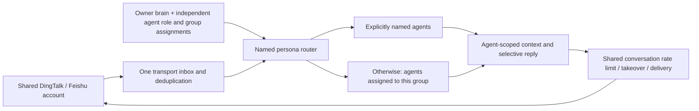

# Message auto-reply service

`src/core/messaging.ts` owns per-account listeners, bounded queues and local task receipts.
`messagingPolicy.ts` validates second-brain rules, restricts knowledge reads and selects triggers.
`messagingDingtalk.ts` uses the native DWS executable with argument arrays (no shell), ready markers,
NDJSON, stable profile IDs and exact reply targets. Existing consumers are never displaced.
`messagingExecutor.ts` owns agent CLI turns, the Copilot adapter, and task-scoped AIChat workers.

AIChat owns the configuration UI and Skill prompt under `.github/skills/message-autoreply/`.
The daemon's local `~/.keepwork-mcp/messaging-v1/` registry is a service binding, not a second brain
registry: root/profile/enabled plus body-free receipts and dedup hashes. Secrets remain in DWS or
CLI-native credential storage; AIChat login stays in process memory. Restart never replays jobs.

## Dashboard channel status

Overview shows separate DingTalk (`dingtalk-cli`) and Feishu (`lark-cli`) cards above
daemon details. `/admin/channels` uses the normal admin authentication and Origin
checks. Read-only `dws profile list` and `lark-cli auth status --json` checks are
single-flight and cached for 60 seconds; binding enabled/listening state is read
fresh on each request. These probes never log in, enable listeners or send messages.
DingTalk lists its returned profiles; Feishu checks bound app profiles (up to ten),
or the default app when unbound. CLI-reported login status is not an online token
validation. Access/refresh expiry timestamps are displayed only when returned by
the CLI; missing timestamps say “CLI 未提供”, not “never expires”. Only selected
account/status/time fields reach the browser; raw responses and credential values
are excluded. Errors in channel checks do not block the rest of Overview.

The authorization badge checks accounts bound to the displayed brain when bindings
exist; expired historical accounts remain visible in details without marking a
valid bound account expired. DWS failures with non-JSON stdout retain uncertain
delivery semantics, but proxy connection failures on stderr now produce a fixed,
credential-free diagnostic. A daemon inherits its launcher's proxy environment:
if a fresh CLI works while the daemon reports a proxy connection failure, correct
the launcher's proxy settings and restart the development task/service (including
its watcher). Restarting only the child under the same watcher retains that environment.
Regression coverage: the dashboard browser fixture includes a valid bound account
and an expired unrelated account; the DWS delivery fixture checks proxy diagnostics,
credential redaction and no fallback send after an uncertain result.

## Startup recovery and multiple computers

### Bot loop protection

Both channels ignore identified app/bot/robot senders and automated reply markers,
including `【AI 代答】` after mentions/whitespace, DingTalk `[interactiveCard]`
placeholders and unsupported-message notices. These checks run before generation
or delivery; no acknowledgement is sent for an ignored automated message.

Automatic replies share one budget per binding/conversation (all group senders
combined). The first six attempts can run immediately. Further attempts are
spaced at least one minute apart and paced across the remaining rolling-hour
budget, normally allowing at most 20 attempts per hour. Ten minutes idle restores
the fast burst but never clears the hourly budget. Reservations are persisted
before generation; actual delivery moves the timestamp forward, and failed or
unknown attempts still count conservatively. Stop/Start, restart and inbox Resume
do not clear this budget. Manual replies are unaffected.

Throttled jobs remain queued (`auto-reply-rate-limit`), without occupying global
execution slots or pausing the inbox. A timer resumes eligible work automatically.
When a conversation has pending work and ten minutes have elapsed since its last
reply attempt, one reply is allowed regardless of the minute/hour budget. This
conversation deadline takes priority: messages are not dropped for rate-limit
expiry. The attempt still counts toward the hourly budget and resets the ten-minute
deadline, so overdue queued messages cannot all burst at once. Model execution,
transport failures and global concurrency may still delay actual delivery. Stop, takeover and shutdown cancel
waiting work; restarts never replay it. The limit counts logical automatic replies,
not the transport's text fragments or card updates.

This bounds rapid unmarked exchanges, not arbitrary bot detection: a bot posing
as a human and replying slowly can still pass these checks. The guard is local to
each daemon; use one enabled computer per account as described below.

After the HTTP daemon starts, `MessagingService.resume()` reads the loaded disk bindings and
starts every binding with `enabled: true`, including DingTalk and Feishu. No AIChat tab or click
is required. Closing the daemon preserves this flag; an explicit Stop persists `enabled: false`
and remains stopped across restarts. A CLI login alone is not a saved messaging binding.

Transport failures and occupied listeners retain the enabled flag and retry every five minutes.
Startup still attempts connection immediately. DingTalk checks status before starting a consumer: existing
consumers or subscriptions are left untouched until the account is free. This also handles
the shutdown overlap when the previous daemon's consumer has not finished exiting. Stale
remote subscriptions can still require inspection in their owning application; MCP never
deletes unknown subscriptions. Invalid credentials, missing CLI and invalid local rules need
repair; automatic recovery does not launch an authorization flow.

This is not a distributed lock. The in-memory identity guard and message deduplication are
local to one daemon. DWS reports remote subscriptions as well as local consumers, but the
status check and subscribe operation are not atomic across computers. Feishu polling has
only local checkpoints and can run on multiple computers, producing duplicate replies.
Use one enabled auto-reply computer per platform account until a shared lease and cross-device
deduplication are implemented. Merely opening MCP on several computers does not enable a new
binding, but previously enabled bindings on all of them will resume independently.

Regression: `restart restores enabled disk bindings without AIChat and waits for an existing
listener to exit` in `scripts/messaging.test.cjs` failed on the original recovery classifier
(`error` instead of `reconnecting`), then passed after the fix. It uses temporary disk state
and isolated CLI fixtures, covering restart, occupancy release, no job replay and explicit Stop;
it is not a live multi-computer acceptance test.

HTTP capability: `/health.messagingApi = "messaging-v1"`. Management routes require an allowed
explicit Origin and the configured daemon authentication:

The Dashboard Personas page also shows the latest 500 received channel messages across all bindings,
newest first, in pages of 50. `/admin/personas.recentMessages` contains channel/account/persona,
conversation/sender, received text, processing state, reason, executor and attempted reply text.
Manual sends do not consume the received-message buffer; automatic reply status updates the incoming entry.
The default filter shows all received entries; Related shows direct messages, mentions and group
messages matching reply rules, excluding self/echo events. Filtering applies within the retained
500 entries, resets pagination, and does not expand platform subscriptions.
`unknown` means delivery is uncertain even when reply text is present. Duplicate deliveries are
omitted; ignored/rejected/failed messages remain visible. Text and reply previews each retain up
to 8000 characters and render as plain text. This additional diagnostic buffer is memory-only,
is not restored from inbox files, and resets on daemon restart; existing inbox persistence is
unchanged. It is exposed only through the existing authenticated/admin-Origin-checked endpoint,
not ordinary messaging status or SSE. Tests cover retention, state updates, restart, pagination
and HTML escaping (`scripts/messaging.test.cjs`, `scripts/dashboard.test.cjs`).

| Method | Route | Payload / result |
| --- | --- | --- |
| GET | `/messaging/config?root=…` | Bindings, current Skill/config and defaults; existing manual rules preserved |
| POST | `/messaging/config` | `{root,profile,config,prompt}`; save and pause listener |
| POST | `/messaging/profiles` | `{root}`; credential-free DWS account identifiers |
| POST | `/messaging/groups` | `{root,profile,query?}`; one bounded page of group identifiers/names |
| GET | `/messaging/status` | Listener state and recent metadata-only receipts |
| GET | `/messaging/events` | Live SSE state snapshots; no message bodies |
| POST | `/messaging/start`, `/messaging/stop` | `{id}`; enable/disable the owned binding |

The no-argument MCP `listen_dingtalk_messages` starts only bindings already enabled in the UI.
The worker HTML at `/messaging/worker#<capability>` strips its fragment immediately.
`/messaging/worker/claim` (POST), `/result` (POST) and `/alive` (GET) require an ephemeral Bearer
capability and `X-Agent-Owner` UUID. Claim is single-use; results are accepted once from its owner.
They never grant access to management endpoints. Worker fetches are same-origin.

The shared daemon lazily launches one headless system Edge/Chrome process using `playwright-core`
and retains it across messaging requests, including concurrent requests. Each task gets a separate
in-memory browser context; completion, cancellation, timeout or failure closes that context.
Daemon shutdown closes the browser, including launches still in progress. Browser crashes fail
in-flight tasks without replay; a later request starts a replacement. Missing browser/startup failures
are reported without opening a visible browser or falling back to the notify bridge. Install Edge/Chrome
or configure `EDGE_PATH` / `CHROME_PATH`. The legacy Local Helper notify endpoint is no longer used.
The iframe uses the existing versioned AIChat bridge and an SDK execution sandbox.
Automatic replies grant second-brain read, list, write and terminal tools, still confined to that folder.
Tasks with no granted catalog keep an empty tool list, and the sandbox rejects every other tool call.

When the shared agent runner is unavailable, Copilot still runs in a private per-task directory
with a unique custom agent (`tools: []`), no custom instructions or built-in MCP, explicit tool
deny rules and denied permission requests. Installed IM replies use the runner instead: craft mode
in the second brain, with native tools accepted and questions declined. No fallback after
submission/unknown result.
Copilot custom-agent behavior follows the [official configuration reference](https://docs.github.com/en/copilot/reference/custom-agents-configuration)
and [CLI reference](https://docs.github.com/en/copilot/reference/copilot-cli-reference/cli-command-reference), checked 2026-10-16.

Automatic persona replies on DingTalk and Feishu use ordinary text. No thinking/progress card
is created, and failures remain in local status rather than sending another message to the peer.
The final answer retains the AI reply marker. DingTalk messages use 6000-byte UTF-8 chunks
with per-part idempotency keys. Unknown delivery outcomes are not automatically retried.
The low-level DWS card adapter remains available in source, but automatic replies do not call it.

Tests: `node --test scripts/messaging.test.cjs scripts/aichat-presence.test.cjs` and
`npm run check:shared`. AIChat's `tests/e2e/messaging.test.mjs` uses Live Server and isolated fixtures.
Actual Copilot/DWS/Keepwork login and reply acceptance require a dedicated account/conversation;
do not count fixture tests as live acceptance or steal an existing listener for verification.

DingTalk and Feishu replies follow the bound persona's executor and always run in that persona's second-brain folder. `keepwork` or `aichat` is a client persona: that owner's connected AIChat page answers, and no agent CLI is started for it. Any other executor uses that agent CLI in craft mode, with its native tools enabled in the brain. `auto` still follows the persona owner's saved AIChat backend and model. A different installed CLI is never substituted. The persona prompt, auto-reply rules and silence instruction still apply; message text, knowledge and tool results cannot cancel them. If the selected CLI is missing or cannot start before submission, the reply uses a connected AIChat client. The persona's own page is preferred, and another page is used only when the owner has none. If no connected client is available, the same reply runs in headless AIChat with the second-brain tools. After a CLI or client turn has been submitted, failure does not fall through to another responder. Explicit executor and model overrides remain supported. The Instance Messaging dashboard shows the current second-brain folder at the top, with the responder (`CLI`, `AIChat 客户端`, or `无界面 AIChat`) and model that served the current or latest reply. When the next reply would use a different route, that route is shown beside it.

Persona Connect uses `POST /agents/personas/:id/channel-connect` with the verified local brain root. It reuses that persona's persisted binding, otherwise selects the current DWS profile and binds it, preserving existing rules. It starts the listener idempotently and returns real listening status. Empty public knowledge selections are permitted and expose no brain files. Saved enabled bindings resume on daemon restart. Messaging state changes notify persona SSE clients. The UI uses AI repair only on connection failure; unsupported daemon versions require an update, never another CLI install.

Enabled listeners automatically recover from initial transient connection failures and disconnects every five minutes, with no retry-count limit. Status is `reconnecting`, includes `nextRetryAt`, and does not invoke AI. Explicit stop cancels retries. Invalid rules, unavailable CLI and invalid authorization require repair; competing listeners are checked again at the same interval. Recovery only recreates subscriptions; it never replays model jobs or delivery attempts.

Known login failures return `needs-login` from persona channel-connect. Explicit `POST /agents/personas/:id/channel-login` runs native `dws auth login` (existing binding profile if present), deduplicates concurrent requests, discards CLI output, waits for completion and reconnects. Background recovery never repeatedly launches browser authorization. The UI handles authorization without an LLM and offers AI diagnosis only after programmatic recovery fails. New devices and revoked credentials can still require DingTalk approval.

## Feishu personal CLI polling

`messagingFeishu.ts` is the personal-user adapter; it never creates a bot, webhook or event subscription. POST `/agents/personas/:id/channel-connect` with `channel: "feishu"` binds the verified appId/userOpenId in the local second brain. Subsequent connections reuse the binding. Enabled bindings resume with the daemon, independently of browser sessions. Snapshots include channel, transport (`polling`), lastPollAt and pollIntervalMs; only a completed sweep sets listening.

Every ten minutes, one tick makes one cross-conversation `im +messages-search` request for the last eleven minutes (one minute of overlap) (50 results maximum), plus identity verification. It never lists chats or polls each conversation. The CLI batch-enriches matching results; one CLI search can therefore involve multiple HTTP requests. Dense windows persist their page token and continue on the next tick, with no auto-pagination burst. Empty windows still cost a search request. Persistent dedup prevents overlap from producing duplicate replies. Transient failures use existing reconnect backoff; scope errors require `search:message` authorization and never fall back to full chat scanning. Search indexing delay can cause missed messages outside the eleven-minute lookback; this is best-effort recent-message polling, not a guaranteed event stream. Downtime is not backfilled except an already pending search page.

Verification: `node --test scripts/messaging.test.cjs scripts/personas.test.cjs`, `npm run check:shared`. Read-only live MCP verification on 2026-10-19 confirmed valid personal user authentication and successful chat/message reads. No real message was sent by acceptance tests.

DingTalk uses event subscriptions for triggers; it reads the active conversation on demand before generation and again before delivery, without periodic history polling. Self-authored group @me events are accepted, while ordinary self messages and AI reply echoes remain filtered. Live upstream delivery of self mentions still requires verification.

### 本机客户端自动监督

Dashboard 首页的“自动随钉钉 / 飞书客户端运行监督”开关保存到 `~/.keepwork-mcp/config.json` 的 `autoFollowImClients`，默认 `true`。Windows 使用进程名，macOS 使用 `ps` 中主程序路径检测 DingTalk / Feishu / Lark；不读取聊天内容、不调用模型，也不将此信号称为桌面登录验证。

启动时立即检查，此后每 5 分钟检查。对应客户端进程存在时，钉钉运行指定 profile 的 `dws auth status`（可由 CLI 刷新已有 token），飞书运行指定 profile 的 `auth status --verify`。认证失败或检测失败时暂停监听并取消排队/进行中的自动回复；不会自动执行交互登录。条件恢复后只恢复已启用的绑定；手动停止和会话防循环暂停不会被覆盖。未配置分身时不会自动创建绑定。

关闭此开关后，已启用的绑定按原有行为独立运行，不再受客户端进程限制。设置是本机设置，并非跨设备锁：两台电脑都运行客户端时仍可能同时满足条件。Windows/macOS 以外系统在开关开启时保持等待，可关闭开关使用独立监听。

`GET /admin/channels` 包含 `supervisor` 检测结果；`POST /admin/channels/supervisor` 接收 `{ "enabled": boolean }`。沿用管理 API 的 Origin / pairing token 检查。

Dashboard 渠道卡片默认展示账号与公司名。已启用的绑定只提供“断开连接”，断开后才能再次“连接”；断开会持久关闭该绑定的监听/自动回复，不退出 CLI 账号。连接操作仍受客户端自动监督条件约束。未绑定渠道通过“连接设置”进入内置 AIChat；“AIChat 排查”加载指定渠道的排查上下文，不携带凭据、不自动调用模型或发送测试消息。`POST /admin/channels/connection` 使用 `{id, action: "connect" | "disconnect"}`，拒绝未先断开的连接请求。

### 飞书完整参与者上下文与静默（2026-10-21）

飞书触发规则忽略普通本人消息和 AI 回声；2026-10-22 起，平台 mentions 中明确 @本人 ID 的本人消息可触发分身回复（单聊和群聊），不将手输的 @名字当作真实提及。轮询收到的本人消息保留在该绑定的本机会话记录中，作为发出消息展示，不计入收件未读。每次准备代答时，通过个人 CLI `+chat-messages-list` 读取当前聊天最新 50 条消息；如果目标消息带有话题 ID，再用 `+threads-messages-list` 读取该话题最新 50 条回复。按消息 ID 去重、时间排序，明确标记本人（人类）、其他参与者及 AI/机器人，不再仅使用单个发言者的历史往返。其他聊天不进入上下文；新增读取不触发自动回复，也不把远端聊天历史导入第二大脑。

这里的完整指覆盖所有参与者，并非无限历史：更早分页不自动追溯，每条正文最多给模型 1000 字符并标注截断，图片等仅显示 CLI 提供的占位信息，不下载附件。目标消息不在当前窗口或已撤回时保持沉默；读取、授权或身份检查失败时不发送无上下文回复。目标正文以本次读取的最新版本为准。

提示词要求本人已回答、讨论已结束或没有必要补充时仅输出 `(...)`。服务吞掉这个独立输出（兼容前置 `【AI 代答】`），记录“模型判断无需回复”，不会向飞书发送该符号。正文中普通提及 `(...)` 不会被当作静默。

非静默答案在发送前再次读取同一聊天及当前话题。若时间线出现新增、修改或撤回，或本机已收到目标消息之后的本人发言，本次答案取消并记录原因；不自动重试旧答案。下一条符合触发规则的新消息按正常队列处理。读取失败同样阻止发送。此机制不能提供飞书服务器上的原子“检查并发送”：最后读取与实际发送之间仍有极短竞态窗口，消息可见性也取决于飞书接口。

验证：`TMPDIR=/private/tmp node --test --test-timeout=30000 scripts/messaging.test.cjs scripts/personas.test.cjs` 全部 68 项通过，`npm run check:shared` 与 `git diff --check` 通过。macOS 默认临时目录的 `/var` 与 `/private/var` 别名会触发现有登录测试路径断言，使用真实临时目录后通过。模拟覆盖本人和多人上下文、话题去重、机器人/媒体占位、静默、自我回声、生成期间本人/他人插话、编辑/撤回及读取失败。未向真实联系人发送测试消息。源码修改需要由运行中的 MCP 加载更新后才生效。

### 钉钉同步采用会话上下文与静默（2026-10-21）

钉钉继续使用事件监听作为触发源，准备代答及发送前通过 `dws chat +chat-messages` 读取当前会话最新 50 条消息，存在话题 ID 时再读取 `+thread-replies` 最新 50 条。单聊使用事件发送者的 openDingTalkId 定位，群聊使用事件会话 ID；全程固定绑定 profile，并验证账号身份。读取结果遵循 `im.message-list.v1`，有失败项或异常不完整结果时不发送；允许单页之后还有更早历史，但不宣称已经读取全部历史。正文长度和附件占位限制与飞书一致。

本人消息保留为本机发出记录，不触发普通自动回复；本人群内显式 @自己的既有入口保留，AI 回声仍被过滤。两渠道共享上下文格式、独立 `(...)` 静默规则及发送前时间线变化检查。模型可在本人已完成回答时选择沉默；生成期间出现新消息、正文变化或读取失败时不会发送过时答案。没有新增全账号轮询，也不会向真实联系人发送测试消息。生效需要 MCP 加载更新后的构建。

钉钉扩展验证：两渠道定向回归 23 项全部通过，`npm run check:shared` 和 `git diff --check` 通过。消息/分身完整套件 75 项中 74 项通过，既有 `real headless browser completes sequential worker handshakes and retains the browser` 用例在 30 秒后超时；不能将本次完整套件报告为通过。该浏览器用例单独复核通过（1/1），保留完整运行的超时记录。未做真实账号发消息验收。

## Single channel brain binding

Each daemon-managed DingTalk/Feishu channel reserves one canonical existing local second-brain directory before invoking its CLI. There is no recent-chat/default-workspace fallback. The two channels have independent reservations, persisted in `channel-roots.json`; disconnect, browser close, daemon restart and new chat presence do not clear or replace them. Dashboard channel cards display `root`; account status probes do not execute without a valid pinned root.

A different directory returns HTTP 409 `{code:"CHANNEL_OCCUPIED", channel, occupiedRoot, requestedRoot, confirmationRequired:true, error}` before starting another listener. AIChat must show the paths and ask whether to switch. After explicit user confirmation, retry persona `channel-connect`/`channel-login`, `/messaging/start`, or dashboard `/admin/channels/connection` with `switchFromRoot` equal to the displayed occupied root. The server checks that value again, stops old channel bindings and pending starts, and persists the new reservation before connecting. A stale confirmation cannot overwrite a newer reservation. Configuration and old-binding restarts cannot silently restore the old directory. Login/session ownership and explicit persona roots remain unchanged.

Verification: `node --test scripts/messaging.test.cjs scripts/channel-status.test.cjs scripts/client-supervisor.test.cjs scripts/dashboard.test.cjs`; isolated UI fixture: `node --test scripts/channel-binding-http.test.cjs scripts/channel-binding-browser.test.cjs`. The fixture exercises displayed paths, cancel and confirm without real accounts or messages.

### Same-brain connection reuse regression

A browser's owner capability and persona ID are not a second-brain path conflict. `channel-connect` for the same canonical brain now joins the existing DingTalk/Feishu binding and reuses its listener. The joining owner/persona is persisted as an authorized peer so subsequent status and inbox requests succeed; repeated joins are idempotent. The original automatic responder and prompt remain unchanged, preventing duplicate replies or a second chat silently replacing the responder. Removing a peer leaves the listener running; removing the primary responder stops it before another peer can resume. Different brain paths still require the explicit switch flow above.

Regression: `scripts/messaging.test.cjs` cases `connectAgent reuses...` and both `shares one listener...` cases cover cross-owner reuse, one listener, unchanged responder, persistent membership, unauthorized access rejection, peer removal and different-root conflicts. This fixes the false “该身份已由其他分身使用” shown when AIChat and the dashboard already used the same brain directory.

### Brain-scoped state display

Persona channel snapshots and channel access resolve the persona's current canonical local brain path from the server's persona registry, rather than requiring a previous Connect call or a matching browser owner. All clients on that path see the same runtime status, errors, enabled state and shared inbox counts immediately. Existing messaging events notify all persona subscribers, so disconnect/reconnect changes refresh every client. Snapshot reads never invoke a CLI, create a peer or start a listener. Live bindings precede historical stopped profiles for clients that display one badge per channel. Clearing/changing a persona's brain immediately removes access to the previous brain even if an old peer association remains on disk.

Regression cases in `scripts/messaging.test.cjs`: `status is shared...` (both channels), `persona snapshots and notifications agree...`, and `shared channel snapshot places...`; `scripts/personas.test.cjs` verifies the current-root resolver. This addresses a grey AIChat channel badge while the dashboard reports the same brain as listening.

### 本人通过 @本人对话（2026-10-22）

无需创建机器人。飞书使用原个人 CLI 和绑定分身，在单聊（包括平台可读取的自己会话）或群聊中，本人发送且 mentions 指向当前账号 ID 的消息可触发分身；单聊仍按单聊读取上下文。普通本人消息、@其他人、纯文本 @名字、AI 回复回声不触发。重复消息仍按 ID 去重，发送前仍检查会话变化。模型提示明确这是本人向分身提问，避免误判为本人已经回答。

钉钉沿用已有本人 @本人事件入口；CLI 上游是否投递仍待真实账号验证。飞书仍约十分钟轮询，不保证即时响应，自己会话的检索可见性及客户端是否提供真实 @操作也需实测。未增加别名配置或任意 @XXX 文本触发。

验证：新增飞书单聊/群聊本人 @本人用例均通过，覆盖真实 mention ID、普通本人消息、@其他人、去重和 AI 回声。`npm run check:shared`、`git diff --check` 通过。消息与分身套件 92 项中 91 项通过，既有真实无头浏览器握手用例超过 30 秒超时；不报告整套通过。未发送真实消息，未重启或部署运行中的 MCP。

## Named persona routing

Assigned-group messages enter each assigned agent's relevance evaluation; irrelevant messages produce `(...)` and no send. In other groups only a name match activates an agent. Explicit names take priority over unnamed home agents; multiple named agents may each respond. Latin names use NFKC, case-insensitive word matching; Chinese names need no spaces. An owner-authored group message naming an agent is eligible even without an account @mention. Automated messages remain excluded, including `【Name · AI】` replies. Direct messages and unclaimed legacy triggers retain their prior behavior; claimed messages do not additionally invoke the default persona.

DingTalk adds `user_im_message_receive_group_all` to the shared event listener while any custom agent is enabled. Feishu retains its existing account-wide message polling and approximately ten-minute cadence. Permission/CLI failures are surfaced through channel status; neither transport can receive inaccessible chats. Configured group names are display labels; channel/account/group ID determine routing.

Incoming messages are stored once. Each replying agent gets its own queued configuration snapshot, receipt/delivery key, prompt and history key. Queue/rate budgets and manual takeover remain per shared conversation. Before sending, recheck current persona, brain, role, assignments, instruction files, reply rules and conversation snapshot. Changes, deletion, cancellation or takeover withhold stale answers. Unknown sends are never automatically replayed. Removing a custom agent preserves a shared connection used by remaining personas. Duplicate copies of the same stable agent identity in registered clients are routed once, preferring the original transport owner.

Custom-agent skill guidance cannot expand external-message permissions: unassigned-group named replies use supplied public knowledge and a tool-free adapter/worker. Assigned-group work uses declared tools and role-prompt write permissions; scope exceptions request owner approval. Existing legacy messaging execution behavior is unchanged. The computer, daemon and CLI authorization must remain available for background processing.

### Group nicknames

Explicit saves in the capable AIChat agent dialog queue a background nickname reconciliation, independently of message reception. For each assigned group the shared account advertises all enabled assigned agents, e.g. `username & A & B`. Use the original group nickname as the base, or the verified account display name when unset. Names are deduplicated and sorted; moving, renaming, disabling or deleting agents removes obsolete names. The last removal restores the exact original nickname, including an unset nickname. Other groups where agents respond only when named are not renamed.

`messagingNicknames.ts` serializes updates and stores only original/base/applied/pending nickname strings under hashed channel/account/group keys in local `group-nicknames.json`. Before writing, read and recheck the current nickname. Manual edits are preserved with a visible conflict. Persist intent before CLI mutation; an uncertain write is reconciled by reading on the next explicit save, never blindly replayed. Corrupt recovery metadata blocks writes. Requests above a conservative 300-byte bound are rejected rather than truncating names; server-side stricter limits surface separately. No nickname writes run on profile hydration, message arrival or daemon startup.

DingTalk uses verified `event status`, `chat group user-settings query --groups`, and self-only `chat group update-nick --conversation-id` (omit `--nick` to clear). Feishu uses verified user identity and `im chat.nickname get/update/delete --as user`; writing may require `im:chat.nickname:write`. A missing current-nickname field, mismatched identity, unsupported CLI or permission failure leaves the nickname untouched. Empty bases use a self-profile read; no other members are queried. No raw diagnostics/credentials are exposed.

HTTP saves accept transient `syncGroupNicknames:true` and return `nicknamePending:true`. Persona snapshots expose owner-scoped `nicknameSync:{pending,warnings}` via existing change notifications; nickname failures never pause replies. `messaging-options` advertises `nicknameVersion:1`; old services keep normal agent settings usable and show the upgrade hint. Deletion only restores groups already managed by this daemon. Tests: `scripts/messaging-nicknames.test.cjs` plus the messaging/persona suites.

### Manual nickname assignments

On already-enabled shared transports, having custom personas subscribes to group messages even when their settings-based group lists are empty. Reception reads the verified account's own nickname. Exact NFKC/case-normalized names in ampersand-delimited slots after the human name add dynamic group assignments; duplicate persona names fail closed. The service never uses another member's nickname or untrusted event text as assignment authority. Discovery is serialized per account/group, capped in memory, refreshed on incoming group messages and before sending, and rebuilt after restart. Read failures remove discovered permissions and surface a channel warning; explicit settings assignments remain intact. Incoming reservations prevent concurrent duplicates while nickname lookup is pending. No channel is started merely by creating a persona.

Owner conversation tools can search accessible groups and edit a target persona's nickname slot after the existing explicit tool approval. They preserve other slots and manual base names, verify account identity and current nickname before writing, and journal uncertain writes. These manual assignments are not copied into portable profile group lists. The dynamic router gives them the same role/skill restrictions, selective silence, takeover and deduplication as settings assignments. Removing a slot removes its dynamic assignment; an independently configured group remains assigned until removed in settings. `nicknameRoutingVersion:1` advertises discovery and conversational assignment support.

Assigned-group work tools are checked at each invocation, not only before the final reply. Shared-brain public reads follow the selected-directory/text-file policy; role-directed repository tools support absolute file paths and command `cwd`. Custom agents default to write capability, with writable/read-only scope defined by the saved role prompt. `agentRolePolicy.ts` instructs the model to execute in-scope work autonomously and set `requireApproval:true` for unclear/out-of-scope actions. This is prompt-based authorization, not a filesystem ACL: the host does not infer arbitrary natural-language path permissions. Scope-exception approvals identify the group and action. Cancellation and configuration/takeover changes still prevent stale tool operations. Existing receipt/tool-call deduplication prevents replay; restart does not resume side effects. Group execution never receives the owner transcript, assignment-management tools or an unrestricted native CLI runner. Role write permission does not authorize disclosure or implicit commits/pushes/deployment.

Nickname reconciliation keeps configured suffixes separate from discovery results: it never computes a managed nickname from its own previously emitted suffix. Manual slots remain in the baseline and are not appended twice after Unicode normalization. Conversational changes retain the settings baseline through uncertain writes. Both plain-group and group-mention events discover self-nickname assignments and allow assigned-group work; the asynchronous read is followed by a second deduplication check. Busy queued/running channel work is exposed to persona rebinding. Role instructions are never silently shortened by the browser worker; oversized instruction payloads fail explicitly.

## Multi-computer coordination

Opt in from Dashboard → Personas → Messaging computers. The verified Keepwork account shares one ordered computer list; each channel identity elects its highest-ranked eligible daemon. Stable installation IDs live in the MCP home, local participation flags in `messaging-v1/coordination-settings.json`, and offline receipt journals in `messaging-v1/coordination/`. Tokens remain in presence memory. Browser closure does not stop coordination.

The server must advertise `account.coordination.v1`. Normal startup uses the Git-ignored `var/coordination/` directory under its checkout; `KEEPWORK_COORDINATION_DIR` is an optional override. Keep this directory across restarts and updates. Preferred return drains accepted work before releasing the 30-second lease (renewed every ten seconds). Shared receipt keys exclude browser owner and local binding IDs. The gateway checkpoints Feishu pagination, takeover state and rate history; message bodies and model context remain local. Seven-day receipts prevent replay of accepted/unknown work; this can sacrifice an interrupted reply rather than repeat it.

Availability-first is deliberate: a gateway confirmed in this daemon run can continue offline, while an online standby may take over after expiry. Duplicates are possible during that partition. Cold starts and standbys never self-promote offline. Reconnect merges offline receipts before restoring eligibility. Manual takeover changes must use the active computer; disconnected state is not synchronously replicated. Existing local-mode services must be stopped/upgraded before enabling coordination; unconnected old services cannot be discovered remotely.

Owner-scoped GET/POST `/agents/personas/messaging-computers` shares persona SSE invalidations. The loopback dashboard uses authenticated `/admin/messaging-computers` (POST additionally checks Origin). Rankings use expected revisions. Ordinary persona chats, schedules, manual sends and remote execution delegation are unchanged. No production server or local daemon is restarted by source verification.
